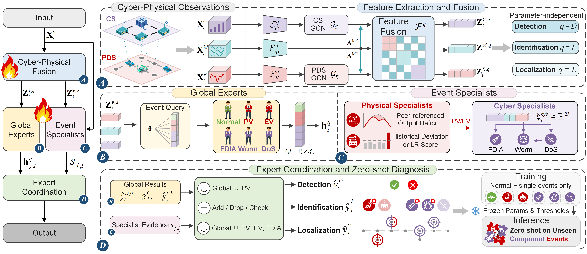

# CPS-MoE: Zero-Shot Detection, Identification, and Localization of Cyber-Physical Compound Events in Power Distribution Systems

Shijie Li1, Qianwen Xu1,\* (\*Corresponding author)

1[Department of Electric Power and Energy Systems](https://www.kth.se/epe/), [KTH Royal Institute of Technology](https://www.kth.se/en), Stockholm, 11428, Sweden

---

## Abstract

With the increasing penetration of photovoltaics and electric vehicles, modern power distribution systems (PDSs) face a higher risk of physical disturbances. During these disturbances, attackers may opportunistically launch cyberattacks, causing the two to jointly impact the PDS as compound events. Because such compound events are difficult to anticipate, existing diagnosis methods that rely on seen event patterns struggle to diagnose them. Moreover, the power and communication features of the constituent events become intermixed, further complicating event identification and node localization. To address these challenges, we propose a novel model named cyber-physical synergistic mixture-of-experts (CPS-MoE), which learns only from normal operation and single events yet achieves zero-shot diagnosis of unseen compound events, covering detection, identification, and node localization. Specifically, the proposed model fuses power and communication features according to the correspondence between nodes and telemetry channels under each remote terminal unit, and combines global experts with physical and cyber event specialists, thereby preserving the distinct features of each event while supplementing local evidence. In addition, the loss for each event is computed without using the samples of other events as negative examples, avoiding implicit mutual exclusion among events. Extensive experiments are conducted on scenarios constructed by the proposed cyber-physical coupled model in the IEEE 34 node and IEEE 123 node test feeders. The results demonstrate that CPS-MoE achieves state-of-the-art performance in diagnosing unseen compound events, with particularly notable advantages in event identification and node localization.

## Introduction of Our Model

- To achieve zero-shot diagnosis of cyber-physical compound events, we propose CPS-MoE, which recognizes the constituent events individually rather than classifying predefined combinations, so it can be trained only on data from normal operation and single events.
- To distinguish and localize events, we fuse power and communication measurements through the correspondence between nodes and telemetry channels under each remote terminal unit (RTU), and build global experts that capture both correlated and independent features of events.
- To prevent local features from being overwhelmed in the holistic representation, we design lightweight specialists for physical and cyber events, which separately extract power variations, telemetry anomalies, and communication degradation to refine the global diagnosis.
- To realistically simulate cyber-physical compound events, we propose a cyber-physical coupled model (CPCM), which constructs scenarios of five single events and six compound events in the IEEE 34 node and IEEE 123 node test feeders, where CPS-MoE consistently achieves the best performance.

## Introduction to CPCM

To evaluate zero-shot diagnosis, test scenarios must reflect how physical events alter the operating states of the PDS and how cyber events distort the telemetry received by the control center, while retaining the labels and affected nodes of each constituent event. CPCM achieves this by coupling each PDS with its RTU-based communication system (CS) (Section III of the paper).

- **PDS.** PV units and EV charging stations (EVCSs) are integrated into the IEEE 34 node and IEEE 123 node test feeders [[1]](#ref1), both with unbalanced three-phase electrical models. The load, PV, and charging data are obtained from [[2]](#ref2) and span the year 2016 at an hourly resolution [[3]](#ref3)-[[6]](#ref6), comprising 8,784 time steps. The PV and charging profiles are normalized by the source PV rated power and charging reference power and rescaled at each node by the rated PV power and the EVCS power limit, respectively, while preserving their temporal patterns. The load, PV, and charging demand are then solved by an unbalanced three-phase power flow, which converges throughout the annual time series.
- **RTU zones.** Following the multi-area partitioning used in distribution system monitoring [[7]](#ref7), [[8]](#ref8), each test feeder is divided along its topology into contiguous and nonoverlapping zones (Fig. 4 of the paper). Each zone is monitored by one RTU that collects all telemetry within the zone, so every node and its telemetry channels belong to exactly one RTU.
- **Communication.** The active and reactive power measurements of loads, PV units, and EVCSs are organized into telemetry channels and assigned to nodes and RTUs. From the received values, source timestamps, and sequence information of each channel, five features are computed for each RTU at each time step, namely the update ratio, timeout ratio, mean data age, maximum data age, and sequence advancement ratio. Communication is lossless in normal operation, so all timeouts and delays arise from cyber events.
- **Ground truth.** The physical states obtained from the power flow are stored separately from the received telemetry, so that the effects of physical and cyber events can be distinguished.

| Test feeder | Nodes | PV units (nodes) | EVCSs (nodes) | RTUs | Nodes with telemetry channels |
| :--- | :---: | :--- | :--- | :---: | :---: |
| IEEE 34 node | 34 | 4 (4, 9, 24, 31) | 2 (26, 31) | 10 | 22 |
| IEEE 123 node | 123 | 6 (13, 28, 47, 64, 91, 111) | 5 (48, 51, 67, 68, 69) | 22 | 88 |

Node numbers follow Fig. 4 of the paper.

### Event Configurations

Each event is characterized by its active period, target scope, and intensity. Event start times are scheduled deterministically, so the datasets are reproducible without random seeds.

| Event | Model | Intensity | Target scope | Duration (time steps) |
| :--- | :--- | :--- | :--- | :---: |
| PV | PV output multiplied by $`1-\alpha^{\mathrm{PV}}`$ | $`\alpha^{\mathrm{PV}}\in[0.28,0.80]`$ | One PV node | 2, 4, or 6 |
| EV | Charging power multiplied by $`1+\alpha^{\mathrm{EV}}`$ and capped at the EVCS power limit | $`\alpha^{\mathrm{EV}}\in[0.33,0.874]`$ | One EVCS | 2, 5, or 8 |
| FDIA | Offset $`\delta_{m,t}=\pm\max(\rho\lvert\zeta_{m,t}^{0}\rvert,0.01)`$ added to the received telemetry, with the sign fixed for each channel | $`\rho\in[0.025,0.085]`$ | All active and reactive power channels of one RTU | 2 or 5 |
| Worm | Telemetry of the infected RTUs delayed by 1 or 2 time steps | Up to 4 RTUs (IEEE 34) or 8 RTUs (IEEE 123) | All channels of the RTUs reached by breadth-first propagation over the RTU network | 5 or 8 |
| DoS | Updates of the targeted RTUs interrupted, with their last received values retained | 1 to 3 RTUs (IEEE 34) or 1 to 7 RTUs (IEEE 123) | All channels of the targeted RTUs | 3 or 5 |

**Compound events.** Six combinations are constructed, namely PV+EV, PV+FDIA, EV+DoS, FDIA+Worm, Worm+DoS, and PV+FDIA+Worm. In each compound event, the constituent events occur simultaneously for 4 time steps and may overlap in target scopes. Their intensities are fixed at $`\alpha^{\mathrm{PV}}=0.45`$, $`\alpha^{\mathrm{EV}}=0.75`$, $`\rho=0.30`$ for FDIA, 3 RTUs for Worm, and 2 RTUs for DoS.

### Scenarios and Labels

For each PDS, CPCM generates 12 annual scenarios, namely normal operation, five single events, and six compound events, while keeping the topology, resource configuration, and measurement assignment unchanged. In total, the two PDSs yield 24 annual scenarios. Each scenario records the physical ground truth, power telemetry, and communication features, together with the labels of event type, active period, and affected nodes of each constituent event.

## Simulation Setting

### Data Partitions

Every scenario is split by calendar month of 2016. All methods are trained and validated only on normal operation and the five single events, and the compound events appear only in the test months, so they remain unseen during training and validation.

| Split | Months | Scenarios |
| :--- | :--- | :--- |
| Training | Jan–Mar, Jun–Aug, Nov | Normal operation and the five single events |
| Validation | Apr–May | Normal operation and the five single events |
| Testing | Sep, Oct, Dec | The six compound events |

Each sample is a window of $`T=12`$ time steps that ends at the diagnosed time step.

### Training Protocol

| Item | Setting |
| :--- | :--- |
| Submodels | Detection, identification, and localization, trained separately |
| Random seeds | 13, 37, 73, 101, and 211, with all reported results averaged over the five seeds |
| Parameter sharing | Under the same seed, each submodel shares its global experts across the two test feeders, while the event specialists and decision thresholds are set separately for each feeder |
| Optimizer | AdamW |
| Batch size | 192 |
| Epochs | Up to 1000, with early stopping on the validation set (patience of 20 epochs) |

The key hyperparameters are listed below (Table I of the paper).

| Hyperparameter | Value | Hyperparameter | Value | Hyperparameter | Value |
| :--- | :---: | :--- | :---: | :--- | :---: |
| Latent dimension $`d_q`$ | 48 | Time steps $`T`$ | 12 | $`\beta_{\mathrm{PV}}`$ | 0.25 |
| Experts | 6 | Retained locations $`K`$ | 7 | $`\beta_{\mathrm{EV}}`$ | 0.10 |
| Optimizer | AdamW | $`\lambda_{\mathrm{loc}}`$ | 0.42 | $`\beta_{\mathrm{FDIA}}`$ | 0.25 |
| Batch size | 192 | $`\lambda_{\mathrm{con}}`$ | 0.06 | $`\beta^{\mathrm{per}}`$ | 0.2 |
| Epochs | 1000 | $`\lambda_{\mathrm{rec}}`$ | 0.08 | $`\tau^{\mathrm{ref}}`$ | 0.15 |
| Patience | 20 | $`\tau^{\mathrm{age}}`$ | 2 | $`\tau^{\mathrm{def}}`$ | 0.15 |
| Decision thresholds | Selected on the validation set and fixed before testing |

### Evaluation

Accuracy, F1-score, precision, and recall are reported for detection, identification, and localization, with anomalies, occurring events, and affected nodes as the positive class, respectively. The metrics are computed over all test windows, so normal windows, absent events, and unaffected nodes contribute true negatives. Because these true negatives dominate, the F1-score better reflects the ability to diagnose compound events (Section V-C of the paper). All results are averaged over the five seeds.

The baselines are Transformer, FEDformer, GCN, STGCN, MegaCRN, MPGTN, and TESTAM, which use the same inputs and data partitions as CPS-MoE.

### Implementation and Hardware

| Item | Setting |
| :--- | :--- |
| Framework | PyTorch 2.0.1 for all neural networks, including the baselines |
| CPS-MoE inference | About 4 GiB of GPU memory with fewer than 1 M trainable parameters, so a single GPU with 8 GB of memory is sufficient |
| Running all baselines | A GPU with at least 12 GB of memory at a batch size of 192 |

Training requires more memory than inference, since intermediate activations are stored for backpropagation. On GPUs with less memory, reduce the batch size.

## Main Results

Zero-shot F1-scores on the six unseen compound events, averaged over five seeds (Table II of the paper).

| F1-score | IEEE 34 node: CPS-MoE | IEEE 34 node: best baseline | IEEE 123 node: CPS-MoE | IEEE 123 node: best baseline |
| :--- | :---: | :---: | :---: | :---: |
| Detection | **0.9279** | 0.7795 (FEDformer) | **0.9506** | 0.8531 (MegaCRN) |
| Identification | **0.8938** | 0.4911 (MegaCRN) | **0.9010** | 0.5277 (MegaCRN) |
| Localization | **0.8781** | 0.4960 (FEDformer) | **0.9395** | 0.2714 (STGCN) |

## Code

The complete code is coming soon.

## References

[1] W. H. Kersting, "Radial distribution test feeders," *IEEE Trans. Power Syst.*, vol. 6, no. 3, pp. 975–985, 1991.

[2] S. Li, J. Lai, H. Li, W. Tang, Y. Xue, and H. Jiang, "CarbonGPT: Meta causal graph-enhanced large language models for carbon emission forecasting in large-scale power distribution networks," *IEEE Trans. Smart Grid*, vol. 17, no. 4, pp. 2797–2809, 2026.

[3] Y. Yuan, K. Dehghanpour, F. Bu, and Z. Wang, "Outage detection in partially observable distribution systems using smart meters and generative adversarial networks," *IEEE Trans. Smart Grid*, vol. 11, no. 6, pp. 5418–5430, 2020.

[4] C. Avraam, L. Ceferino, and Y. Dvorkin, "Operational and economy-wide impacts of compound cyber-attacks and extreme weather events on electric power networks," *Appl. Energy*, vol. 349, p. 121577, 2023.

[5] S. Bhattacharjee and S. K. Das, "Detection and forensics against stealthy data falsification in smart metering infrastructure," *IEEE Trans. Dependable Secure Comput.*, vol. 18, no. 1, pp. 356–371, 2021.

[6] A. Wang, W. Chang, S. Chen, and A. Mohaisen, "Delving into Internet DDoS attacks by botnets: Characterization and analysis," *IEEE/ACM Trans. Netw.*, vol. 26, no. 6, pp. 2843–2855, 2018.

[7] C. Muscas, M. Pau, P. A. Pegoraro, S. Sulis, F. Ponci, and A. Monti, "Multiarea distribution system state estimation," *IEEE Trans. Instrum. Meas.*, vol. 64, no. 5, pp. 1140–1148, 2015.

[8] X. Zhou, Z. Liu, Y. Guo, C. Zhao, J. Huang, and L. Chen, "Gradient-based multi-area distribution system state estimation," *IEEE Trans. Smart Grid*, vol. 11, no. 6, pp. 5325–5338, 2020.
